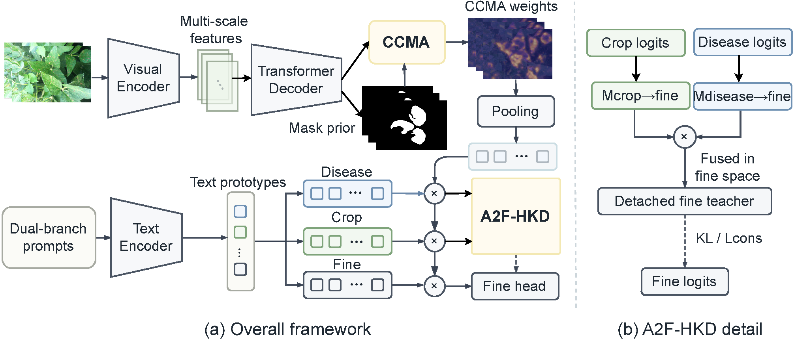
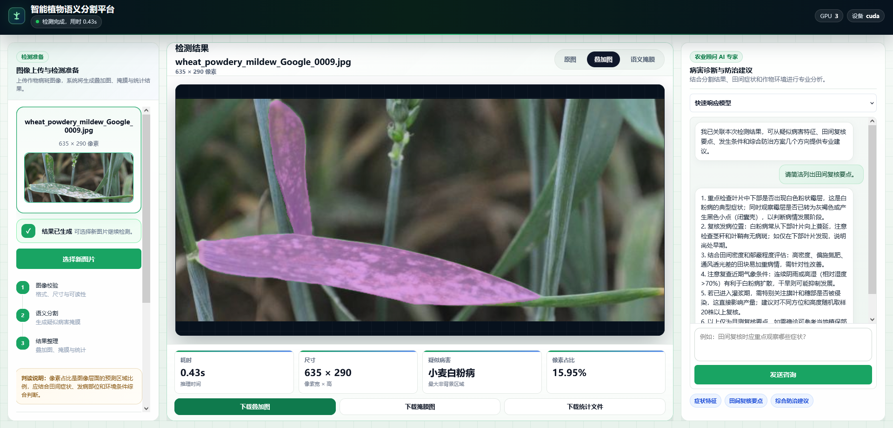

<h1 align="center">TaxoSeg</h1>

<p align="center">
  面向作物病害场景的分类层级感知语义分割代码库
</p>

<p align="center">
  
  
  
  <a href="LICENSE"></a>
</p>

## :seedling: 摘要

TaxoSeg 是一个基于 Detectron2 的分类层级感知作物病害语义分割研究代码库，面向细粒度病斑类别同时由作物身份和病害类型共同定义的田间场景。项目基于 CLIP mask classification 框架，利用固定的作物-病害语义结构，在训练、预测和诊断评估中连接细粒度标签、作物因子和病害因子。

<p align="center">
  
</p>

## :sparkles: 方法特点

- **结构化作物-病害预测**：将每个细粒度病斑标签连接到作物因子和病害因子，用于分类层级感知训练和诊断导向评估。
- **A2F-HKD**：将作物和病害辅助预测投影到细粒度标签空间，并以二者兼容性作为 detached soft target 约束细粒度分类。
- **CCMA**：向 query-region 分类过程注入作物感知视觉上下文，缓解视觉症状相似导致的类别混淆。
- **双分支文本原型**：结合规范类别名提示和分类层级派生的描述性提示，增强 CLIP 语义锚定。
- **开源 WheatField-Seg 数据集**：提供面向外部评估的小麦田间病害语义分割数据集。

## :computer: 部署预览

我们正在开发面向实际作物病害分析的部署原型。目前界面支持 TaxoSeg 病斑分割与识别结果展示，并结合病害 VLM 大模型进行病害识别和交互式农学分析。该部分属于下一篇工作的初步探索，重点是将 TaxoSeg 与面向病害诊断的视觉语言模型结合。

<p align="center">
  
</p>

## :wrench: 安装

创建 Python 3.8 环境：

```bash
conda create -n taxoseg python=3.8 -y
conda activate taxoseg
export PYTHONNOUSERSITE=1
```

```bash
python -m pip install torch==1.10.1+cu111 torchvision==0.11.2+cu111 \
  -f https://download.pytorch.org/whl/torch_stable.html

python -m pip install detectron2 \
  -f https://dl.fbaipublicfiles.com/detectron2/wheels/cu111/torch1.10/index.html
```

安装其余依赖，并编译 MSDeformAttn：

```bash
python -m pip install -r requirements.txt

cd taxoseg/modeling/pixel_decoder/ops
sh make.sh
cd ../../../..
```

## :rocket: 训练与评估

我们将在论文正式发表后公开下载链接，请单独下载 `WheatField-Seg`，并设置数据集根目录。

```bash
export TAXOSEG_DATASETS=/path/to/datasets
```

单卡训练：

```bash
python train_net.py \
  --config-file configs/wheatfield/taxoseg_convnext_large_wheatfield_semseg.yaml \
  --num-gpus 1
```

多卡训练：

```bash
python train_net.py \
  --config-file configs/wheatfield/taxoseg_convnext_large_wheatfield_semseg.yaml \
  --num-gpus 8
```

在默认验证集上评估：

```bash
python train_net.py \
  --config-file configs/wheatfield/taxoseg_convnext_large_wheatfield_semseg.yaml \
  --eval-only \
  MODEL.WEIGHTS /path/to/checkpoint.pth
```

## :memo: 许可与致谢

TaxoSeg 使用 [Apache License 2.0](LICENSE) 发布。部分实现基于 Apache-2.0 兼容的语义分割和目标检测开源项目改写，并在适用位置保留了上游版权说明。

归属说明见 [NOTICE](NOTICE)。
